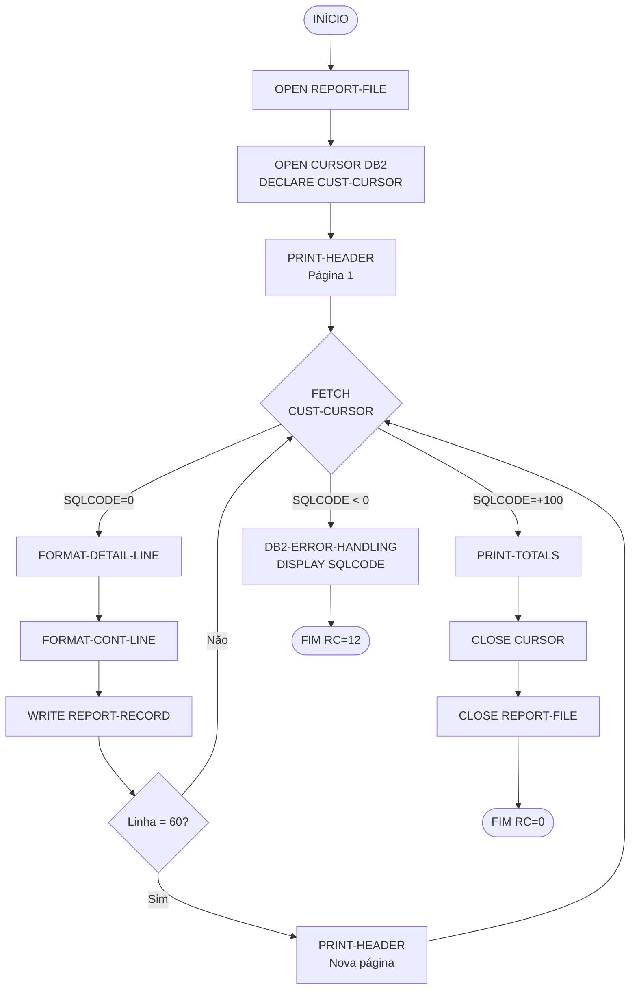

# Especificação Técnica — Programa Batch LSTCUST

**Versão:** 1.0  
**Data:** 2025-07-09  
**Autor:** Gerado via IBM Bob Z Architect  
**Status:** Rascunho

---

## 1. Identificação do Programa

| Atributo            | Valor                          |
|---------------------|--------------------------------|
| Nome do Programa    | LSTCUST                        |
| Linguagem           | COBOL                          |
| Tipo                | Batch — relatório sequencial   |
| Execução            | Via JCL, STEP próprio          |
| Dataset de Saída    | RAFAELT.BANK.LSTCUST.REPORT    |

---

## 2. Objetivo

Gerar um relatório sequencial listando **todos os customers** cadastrados na tabela DB2 `CUSTOMER`, sem aplicação de filtros, exibindo todos os campos disponíveis no registro. O relatório deve incluir cabeçalho de página, colunas alinhadas, numeração de linhas e totalizador ao final.

---

## 3. Origem dos Dados

### 3.1 Tabela DB2 — CUSTOMER

Fonte principal de dados, declarada no copybook [`CUSTDB2.cpy`](src/base/cics/copy/CUSTDB2.cpy).

| Coluna                     | Tipo DB2         | Descrição                              |
|----------------------------|------------------|----------------------------------------|
| CUSTOMER_EYECATCHER        | CHAR(4)          | Identificador de registro (`CUST`)     |
| CUSTOMER_SORTCODE          | CHAR(6) NOT NULL | Sort code da agência                   |
| CUSTOMER_NUMBER            | CHAR(10) NOT NULL| Número único do customer               |
| CUSTOMER_TITLE             | CHAR(10)         | Título (Sr., Sra., Dr., etc.)          |
| CUSTOMER_FIRST_NAME        | CHAR(50)         | Primeiro nome                          |
| CUSTOMER_LAST_NAME         | CHAR(50)         | Sobrenome                              |
| CUSTOMER_DATE_OF_BIRTH     | INTEGER          | Data de nascimento (formato YYYYMMDD)  |
| CUSTOMER_PHONE             | CHAR(20)         | Telefone                               |
| CUSTOMER_ADDR_LINE1        | CHAR(50)         | Endereço — linha 1                     |
| CUSTOMER_ADDR_LINE2        | CHAR(50)         | Endereço — linha 2                     |
| CUSTOMER_CITY              | CHAR(50)         | Cidade                                 |
| CUSTOMER_POSTCODE          | CHAR(10)         | CEP / código postal                    |
| CUSTOMER_COUNTRY           | CHAR(50)         | País                                   |
| CUSTOMER_STATUS            | CHAR(10)         | Status (`ACTIVE`, `INACTIVE`, `SUSPENDED`) |
| CUSTOMER_CREATED_DATE      | INTEGER          | Data de criação (formato YYYYMMDD)     |
| CUSTOMER_CREDIT_SCORE      | SMALLINT         | Score de crédito (0–999)               |
| CUSTOMER_CS_REVIEW_DATE    | INTEGER          | Data da última revisão de crédito      |

### 3.2 Copybooks Referenciados

| Copybook                                               | Finalidade                           |
|--------------------------------------------------------|--------------------------------------|
| [`CUSTOMER.cpy`](src/base/cics/copy/CUSTOMER.cpy)     | Estrutura COBOL do registro customer |
| [`CUSTDB2.cpy`](src/base/cics/copy/CUSTDB2.cpy)       | DECLARE TABLE DB2                    |
| [`SORTCODE.cpy`](src/base/cics/copy/SORTCODE.cpy)     | Sort code da instalação (987654)     |

---

## 4. Regras de Negócio

1. **Sem filtros:** Todos os customers da tabela devem ser listados, independente de status, sort code ou qualquer outro critério.
2. **Ordenação:** Por `CUSTOMER_SORTCODE` ASC, depois `CUSTOMER_NUMBER` ASC.
3. **Datas:** Os campos de data (`CUSTOMER_DATE_OF_BIRTH`, `CUSTOMER_CREATED_DATE`, `CUSTOMER_CS_REVIEW_DATE`) são armazenados como INTEGER no formato `YYYYMMDD`. O relatório deve exibi-los no formato `DD/MM/YYYY`.
4. **Score de crédito:** Exibir como inteiro com 3 dígitos (ex.: `850`). Se nulo, exibir `N/A`.
5. **Status:** Exibir o valor literal do campo (`ACTIVE`, `INACTIVE`, `SUSPENDED`).
6. **Totalizador:** Ao final do relatório, imprimir o total de customers listados.

---

## 5. Lógica de Processamento

```
INÍCIO
  ABRIR cursor DB2 (SELECT * FROM CUSTOMER ORDER BY SORTCODE, NUMBER)
  IMPRIMIR cabeçalho do relatório
  INICIALIZAR contador de customers = 0

  LOOP — FETCH cursor
    SE SQLCODE = 0
      FORMATAR linha de detalhe
      IMPRIMIR linha de detalhe
      INCREMENTAR contador
      SE linha atual = última linha da página
        IMPRIMIR rodapé de página
        INCREMENTAR número de página
        IMPRIMIR novo cabeçalho
    SE SQLCODE = +100 (não encontrado / fim dos dados)
      SAIR do LOOP
    SE SQLCODE < 0 (erro DB2)
      REGISTRAR erro em SYSOUT
      FECHAR cursor
      ABEND com código de retorno 12

  FECHAR cursor
  IMPRIMIR linha totalizadora
  IMPRIMIR rodapé final
FIM
```


---

## 6. Estrutura do Relatório

### 6.1 Layout de Página

- **Largura:** 132 colunas
- **Linhas por página:** 60 linhas de detalhe (mais cabeçalho e rodapé)
- **Espaçamento:** simples (1 linha por registro)

### 6.2 Cabeçalho (Header) — repetido a cada nova página

```
Cols 1–132:
┌──────────────────────────────────────────────────────────────────────────────────────────────────────────────────────────────────────┐
│ BANCO XYZ — LISTAGEM GERAL DE CUSTOMERS                               DATA: DD/MM/YYYY   HORA: HH:MM:SS   PAG.: ZZZZZ               │
│                                                                                                                                      │
│ LIN  SORTCODE  CUST-NUMBER  TITULO  NOME COMPLETO                     STATUS     TELEFONE             CIDADE              CR-SCORE  │
│ ---- --------  -----------  ------  ---------------------------------- ---------- -------------------- ------------------- ---------  │
└──────────────────────────────────────────────────────────────────────────────────────────────────────────────────────────────────────┘
```

#### Campos do Cabeçalho

| Campo          | Formato         | Posição inicial |
|----------------|-----------------|-----------------|
| Título fixo    | Literal         | Col 1           |
| DATA           | DD/MM/YYYY      | Col 72          |
| HORA           | HH:MM:SS        | Col 90          |
| PAG.           | ZZZZZ (numérico)| Col 110         |

### 6.3 Linha de Detalhe

```
LIN   SORTCODE  CUST-NUMBER   TITULO    NOME COMPLETO                    STATUS      TELEFONE             CIDADE               CR-SCORE
ZZZZZ 999999    9999999999    XXXXXXXXX XXXX...XXXX XXXX...XXXX          XXXXXXXXXX  XXXXXXXXXXXXXXXXXXXX XXXXXXXXXXXXXXXXXXXXXXXXX ZZZ
```

#### Mapeamento de Campos — Linha de Detalhe

| Campo              | Posição (Col) | Tamanho | PIC           | Origem DB2                        |
|--------------------|---------------|---------|---------------|-----------------------------------|
| Nº linha           | 1             | 5       | ZZZZZ         | Contador interno                  |
| Sort code          | 8             | 6       | 9(6)          | CUSTOMER_SORTCODE                 |
| Nº customer        | 16            | 10      | 9(10)         | CUSTOMER_NUMBER                   |
| Título             | 28            | 10      | X(10)         | CUSTOMER_TITLE                    |
| Nome completo      | 40            | 61      | X(50)+X(1)+X(10) | FIRST_NAME + ' ' + LAST_NAME   |
| Status             | 103           | 10      | X(10)         | CUSTOMER_STATUS                   |
| Telefone           | 115           | 20      | X(20)         | CUSTOMER_PHONE                    |
| Cidade             | 137           | 20      | X(20)         | CUSTOMER_CITY (truncado)          |
| Score crédito      | 159           | 3       | ZZZ ou 'N/A'  | CUSTOMER_CREDIT_SCORE             |

> **Observação:** Para colunas adicionais (endereço completo, data de nascimento, data de criação, data de revisão), imprimir em linha de continuação logo abaixo do registro principal, indentada 6 espaços.

### 6.4 Linha de Continuação (segunda linha por registro)

```
      END: DD/MM/YYYY  CRIADO: DD/MM/YYYY  REV.CRED: DD/MM/YYYY  PAIS: XXXXXXXXX..X  CEP: XXXXXXXXXX
```

| Campo              | Origem DB2                    | Formato     |
|--------------------|-------------------------------|-------------|
| Data nascimento    | CUSTOMER_DATE_OF_BIRTH        | DD/MM/YYYY  |
| Data criação       | CUSTOMER_CREATED_DATE         | DD/MM/YYYY  |
| Data revisão créd. | CUSTOMER_CS_REVIEW_DATE       | DD/MM/YYYY  |
| País               | CUSTOMER_COUNTRY              | X(50)       |
| CEP                | CUSTOMER_POSTCODE             | X(10)       |
| Endereço completo  | ADDR_LINE1 + ADDR_LINE2       | X(50)+X(50) |

### 6.5 Totalizador Final

```
      ================================================================================
      TOTAL DE CUSTOMERS LISTADOS: ZZZZZZZZZ
      ================================================================================
```

---

## 7. Estrutura do Programa COBOL

### 7.1 IDENTIFICATION DIVISION

```cobol
       IDENTIFICATION DIVISION.
       PROGRAM-ID. LSTCUST.
       AUTHOR.     IBM Bank-of-Z.
       DATE-WRITTEN. 2025-07-09.
```

### 7.2 ENVIRONMENT DIVISION

```cobol
       ENVIRONMENT DIVISION.
       CONFIGURATION SECTION.
       INPUT-OUTPUT SECTION.
       FILE-CONTROL.
           SELECT REPORT-FILE
               ASSIGN TO LSTOUT
               ORGANIZATION IS SEQUENTIAL
               ACCESS MODE IS SEQUENTIAL.
```

### 7.3 DATA DIVISION

#### FILE SECTION

```cobol
       FD  REPORT-FILE
           RECORDING MODE IS F
           BLOCK CONTAINS 0 RECORDS
           RECORD CONTAINS 133 CHARACTERS.
       01  REPORT-RECORD               PIC X(133).
```

#### WORKING-STORAGE SECTION — Principais grupos

```cobol
       01  WS-SWITCHES.
           05  WS-EOF-SW               PIC X VALUE 'N'.
               88  WS-EOF              VALUE 'Y'.
           05  WS-DB2-ERROR-SW         PIC X VALUE 'N'.
               88  WS-DB2-ERROR        VALUE 'Y'.

       01  WS-COUNTERS.
           05  WS-LINE-COUNT           PIC 9(5) VALUE ZEROS.
           05  WS-PAGE-COUNT           PIC 9(5) VALUE ZEROS.
           05  WS-CUST-COUNT           PIC 9(9) VALUE ZEROS.
           05  WS-LINES-PER-PAGE       PIC 9(3) VALUE 60.

       01  WS-DATE-WORK.
           05  WS-CURRENT-DATE         PIC X(8).
           05  WS-CURRENT-TIME         PIC X(6).
           05  WS-DATE-FORMATTED       PIC X(10).
           05  WS-TIME-FORMATTED       PIC X(8).

       01  WS-DATE-CONVERT.
           05  WS-INT-DATE             PIC 9(8).
           05  WS-INT-DATE-GRP REDEFINES WS-INT-DATE.
               10  WS-INT-YYYY         PIC 9(4).
               10  WS-INT-MM           PIC 9(2).
               10  WS-INT-DD           PIC 9(2).

       EXEC SQL
           INCLUDE SQLCA
       END-EXEC.

       EXEC SQL
           INCLUDE CUSTDB2
       END-EXEC.

       01  HOST-CUSTOMER-ROW.
           03  HV-CUSTOMER-EYECATCHER   PIC X(4).
           03  HV-CUSTOMER-SORTCODE     PIC X(6).
           03  HV-CUSTOMER-NUMBER       PIC X(10).
           03  HV-CUSTOMER-TITLE        PIC X(10).
           03  HV-CUSTOMER-FIRST-NAME   PIC X(50).
           03  HV-CUSTOMER-LAST-NAME    PIC X(50).
           03  HV-CUSTOMER-DOB          PIC S9(9) COMP.
           03  HV-CUSTOMER-PHONE        PIC X(20).
           03  HV-CUSTOMER-ADDR-LINE1   PIC X(50).
           03  HV-CUSTOMER-ADDR-LINE2   PIC X(50).
           03  HV-CUSTOMER-CITY         PIC X(50).
           03  HV-CUSTOMER-POSTCODE     PIC X(10).
           03  HV-CUSTOMER-COUNTRY      PIC X(50).
           03  HV-CUSTOMER-STATUS       PIC X(10).
           03  HV-CUSTOMER-CREATE-DATE  PIC S9(9) COMP.
           03  HV-CUSTOMER-CREDIT-SCORE PIC S9(4) COMP.
           03  HV-CUSTOMER-CS-REVIEW    PIC S9(9) COMP.

       01  NULL-INDICATORS.
           05  NI-TITLE                 PIC S9(4) COMP-5.
           05  NI-PHONE                 PIC S9(4) COMP-5.
           05  NI-ADDR-LINE2            PIC S9(4) COMP-5.
           05  NI-DOB                   PIC S9(4) COMP-5.
           05  NI-CREDIT-SCORE          PIC S9(4) COMP-5.
           05  NI-CS-REVIEW             PIC S9(4) COMP-5.
```

### 7.4 PROCEDURE DIVISION — Seções

| Seção                   | Responsabilidade                                         |
|-------------------------|----------------------------------------------------------|
| `MAIN-PROCESS`          | Ponto de entrada; controla o fluxo geral                 |
| `OPEN-FILES`            | Abre REPORT-FILE e o cursor DB2                          |
| `PRINT-HEADER`          | Imprime cabeçalho de página; incrementa página           |
| `FETCH-CUSTOMERS`       | FETCH do cursor; detecta fim de dados e erros DB2        |
| `FORMAT-DETAIL-LINE`    | Formata linha principal do registro                      |
| `FORMAT-CONT-LINE`      | Formata linha de continuação (datas e endereço)          |
| `CONVERT-INT-DATE`      | Converte INTEGER YYYYMMDD para DD/MM/YYYY                |
| `PRINT-TOTALS`          | Imprime linha totalizadora                               |
| `CLOSE-FILES`           | Fecha REPORT-FILE e cursor DB2                           |
| `DB2-ERROR-HANDLING`    | Registra SQLCODE/SQLERRM em SYSOUT e encerra com RC=12   |

---

## 8. Cursor DB2

```cobol
       EXEC SQL
           DECLARE CUST-CURSOR CURSOR FOR
               SELECT CUSTOMER_EYECATCHER,
                      CUSTOMER_SORTCODE,
                      CUSTOMER_NUMBER,
                      CUSTOMER_TITLE,
                      CUSTOMER_FIRST_NAME,
                      CUSTOMER_LAST_NAME,
                      CUSTOMER_DATE_OF_BIRTH,
                      CUSTOMER_PHONE,
                      CUSTOMER_ADDR_LINE1,
                      CUSTOMER_ADDR_LINE2,
                      CUSTOMER_CITY,
                      CUSTOMER_POSTCODE,
                      CUSTOMER_COUNTRY,
                      CUSTOMER_STATUS,
                      CUSTOMER_CREATED_DATE,
                      CUSTOMER_CREDIT_SCORE,
                      CUSTOMER_CS_REVIEW_DATE
               FROM   CUSTOMER
               ORDER  BY CUSTOMER_SORTCODE ASC,
                         CUSTOMER_NUMBER   ASC
       END-EXEC.
```

### Controle do Laço de FETCH

```cobol
       EXEC SQL OPEN CUST-CURSOR END-EXEC.
       IF SQLCODE NOT EQUAL ZERO
           PERFORM DB2-ERROR-HANDLING
       END-IF.

       PERFORM FETCH-LOOP
           UNTIL SQLCODE NOT EQUAL ZERO.

       IF SQLCODE = +100
           PERFORM PRINT-TOTALS
           PERFORM CLOSE-FILES
       ELSE
           PERFORM DB2-ERROR-HANDLING
       END-IF.
```

> **Regra crítica (IBM):** O laço deve usar `UNTIL SQLCODE NOT EQUAL ZERO` — não `UNTIL SQLCODE = +100`. Após sair do laço, distinguir `+100` (normal) de valor negativo (erro).

### Tratamento de SQLCODE

| SQLCODE  | Situação                  | Ação                                           |
|----------|---------------------------|------------------------------------------------|
| 0        | Sucesso                   | Processar registro                             |
| +100     | Fim dos dados (NOT FOUND) | Sair do loop, imprimir totalizador             |
| Negativo | Erro DB2                  | DISPLAY SQLCODE e SQLERRM; encerrar RC=12      |

---

## 9. Conversão de Datas

Os campos `CUSTOMER_DATE_OF_BIRTH`, `CUSTOMER_CREATED_DATE` e `CUSTOMER_CS_REVIEW_DATE` são armazenados como `INTEGER` no formato `YYYYMMDD`.

**Declaração da host variable de data (INTEGER YYYYMMDD):**

```cobol
       01  WS-DATE-INT-WORK          PIC S9(8) COMP.
       01  WS-DATE-INT-DISP REDEFINES WS-DATE-INT-WORK
                                     PIC 9(8).
       01  WS-DATE-INT-GRP REDEFINES WS-DATE-INT-WORK.
           05  WS-DATE-YYYY          PIC 9(4).
           05  WS-DATE-MM            PIC 9(2).
           05  WS-DATE-DD            PIC 9(2).
```

**Lógica de conversão (seção `CONVERT-INT-DATE`):**

```cobol
       CONVERT-INT-DATE.
           IF NI-DATE-IN < ZERO
               MOVE 'N/A       '    TO WS-DATE-FORMATTED
           ELSE
               MOVE HV-DATE-IN      TO WS-DATE-INT-WORK
               STRING WS-DATE-DD    DELIMITED SIZE
                      '/'           DELIMITED SIZE
                      WS-DATE-MM    DELIMITED SIZE
                      '/'           DELIMITED SIZE
                      WS-DATE-YYYY  DELIMITED SIZE
                  INTO WS-DATE-FORMATTED
           END-IF.
```

> **Nota (IBM):** O null indicator deve ser verificado **antes** de tentar formatar. `NI < 0` (tipicamente `-1`) indica coluna NULL — a host variable não deve ser usada.

---

## 10. Arquivo de Saída (QSAM)

| Atributo            | Valor                          |
|---------------------|--------------------------------|
| DSN                 | RAFAELT.BANK.LSTCUST.REPORT    |
| Organização         | PS (Physical Sequential)       |
| Formato de registro | FB (Fixed Block)               |
| LRECL               | 133                            |
| BLKSIZE             | 27930 (múltiplo de 133)        |
| RECFM               | FB                             |
| DD Name (JCL)       | LSTOUT                         |
| DISP                | (NEW,CATLG,DELETE)             |
| SPACE               | (TRK,(50,10),RLSE)             |

---

## 11. Especificação do JCL

**Arquivo:** `src/base/batch/jcl/LSTCUST.jcl`

```jcl
//LSTCUST  JOB 'Customer List',NOTIFY=&SYSUID,CLASS=A,
//          MSGCLASS=H,MSGLEVEL=(1,1),REGION=4M
//*=============================================================
//* JOB: LSTCUST
//* DESC: LISTAGEM GERAL DE CUSTOMERS - BANCO XYZ
//* PROG: LSTCUST
//* SAIDA: RAFAELT.BANK.LSTCUST.REPORT
//*=============================================================
//STEP1    EXEC PGM=IKJEFT01
//STEPLIB  DD  DISP=SHR,DSN=DB2V13.SDSNEXIT
//         DD  DISP=SHR,DSN=DB2V13.SDSNLOAD
//         DD  DISP=SHR,DSN=BANKZ.V0R1M0.LOAD
//LSTOUT   DD  DSN=RAFAELT.BANK.LSTCUST.REPORT,
//             DISP=(NEW,CATLG,DELETE),
//             SPACE=(TRK,(50,10),RLSE),
//             DCB=(RECFM=FB,LRECL=133,BLKSIZE=27930)
//SYSPRINT DD   SYSOUT=*
//SYSOUT   DD   SYSOUT=*
//SYSTSPRT DD   SYSOUT=*
//SYSTSIN  DD *
 DSN SYSTEM(DBD1)
 RUN  PROGRAM(LSTCUST) PLAN(BANKZPLN) -
      LIB('BANKZ.V0R1M0.LOAD')
 END
/*
```

---

## 12. Códigos de Retorno

| RC | Significado                              |
|----|------------------------------------------|
| 0  | Execução bem-sucedida                    |
| 4  | Aviso — nenhum customer encontrado       |
| 8  | Erro de I/O no arquivo de saída          |
| 12 | Erro DB2 (SQLCODE negativo)              |

---

## 13. Estimativa de Volume e Performance

| Parâmetro                  | Estimativa                |
|----------------------------|---------------------------|
| Volume esperado            | Até 1.000.000 de registros |
| Tempo de execução esperado | < 5 minutos               |
| Tamanho do dataset saída   | ~600 MB (estimado)        |
| Método de acesso DB2       | Cursor sequencial com ORDER BY |
| Índice utilizado           | PK (SORTCODE + NUMBER)    |

---

## 14. Dependências e Pré-requisitos

| Item                        | Detalhe                                        |
|-----------------------------|------------------------------------------------|
| Plano DB2                   | `BANKZPLN` deve incluir o programa `LSTCUST`   |
| Bind do cursor              | Realizar BIND antes da primeira execução       |
| Autorização DB2             | SELECT na tabela `CUSTOMER`                    |
| Dataset de saída            | Deve não existir antes da execução (NEW)       |
| Copybooks obrigatórios      | `CUSTDB2`, `CUSTOMER`, `SORTCODE`              |
| Load library                | `BANKZ.V0R1M0.LOAD`                            |

---

## 15. Considerações de Teste

### 15.1 Cenários de Teste

| ID   | Cenário                                   | Resultado Esperado               |
|------|-------------------------------------------|----------------------------------|
| TC01 | Tabela com dados — execução normal        | RC=0, relatório gerado           |
| TC02 | Tabela sem registros                      | RC=4, relatório com totalizador 0 |
| TC03 | Erro de conexão DB2 (SQLCODE -30081)      | RC=12, mensagem em SYSOUT        |
| TC04 | Dataset de saída já existente             | JCL ABEND com erro de alocação   |
| TC05 | Datas nulas em campos opcionais           | Campo exibido como `N/A`         |
| TC06 | Todos os status presentes (3 valores)     | Todos exibidos corretamente      |
| TC07 | Paginação — mais de 60 registros          | Cabeçalho repetido na pág. 2     |

---

## 16. Diagrama de Fluxo



---

## 17. Localização dos Artefatos

| Artefato               | Caminho no Workspace                              |
|------------------------|---------------------------------------------------|
| Programa COBOL         | `src/base/batch/cobol/LSTCUST.cbl` *(a criar)*    |
| JCL de execução        | `src/base/batch/jcl/LSTCUST.jcl` *(a criar)*      |
| Copybook CUSTOMER      | `src/base/cics/copy/CUSTOMER.cpy`                 |
| Copybook CUSTDB2       | `src/base/cics/copy/CUSTDB2.cpy`                  |
| Copybook SORTCODE      | `src/base/cics/copy/SORTCODE.cpy`                 |
| Esta especificação     | `.bobz/specs/LSTCUST-technical-spec.md`            |

---

*Especificação gerada pelo IBM Bob Z Architect — Bank-of-Z workspace*
